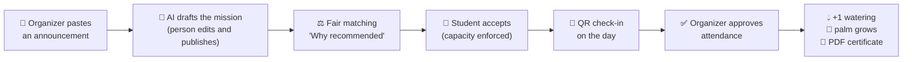
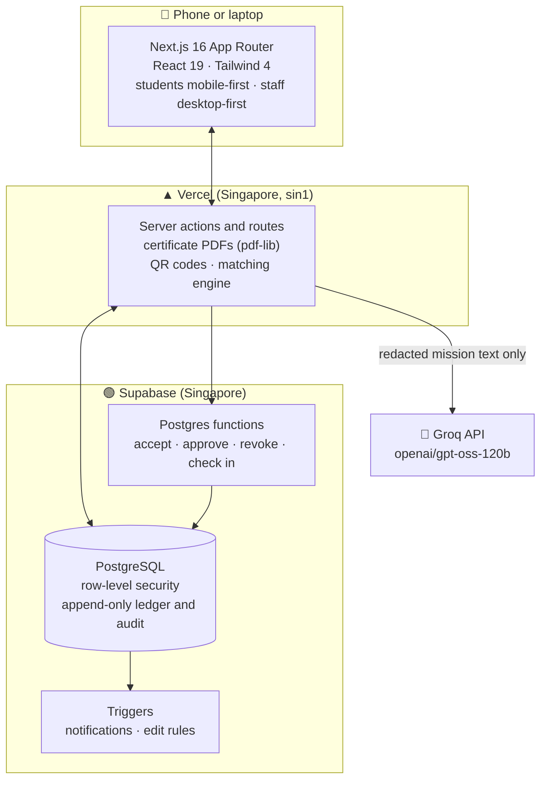

<div align="center">

<picture>
  <source media="(prefers-color-scheme: dark)" srcset="public/brand/logo-on-dark.png">
  
</picture>

# Voluntree: Fair Campus Volunteering

**Every student deserves a turn to help.**
Voluntree fills AIU's event volunteer slots *fairly*: AI drafts the missions, a transparent score lifts the students who've had the fewest chances,
and every approved participation earns a certificate and waters the student's own date palm.

**[▶ Try it live: joinvoluntree.vercel.app](https://joinvoluntree.vercel.app)** · no sign-up, one tap per role

*MMC Upstart 2026 Catalyst · Focus Area 02: Smart Campus and Institutional Systems*

</div>

---

## Judge's 5-minute tour

Everything below runs on the live site with synthetic demo data. Pick a role on the sign-in page: one tap, no password.

| Rubric criterion | Where to look | What you'll see |
|---|---|---|
| **Problem relevance and impact** (20) | [The problem](#the-problem) · [From evidence to design](#from-evidence-to-design) · [Results](#does-it-work-the-evidence) | Our survey of 20 students: **7 of 13 applicants turned away** at least once, **4 of 13 volunteers never got a certificate**. Then how much fairer the matching is on simulated data |
| **Technical execution** (25) | Sign in as **Madam Fazilah** (organizer) → open a mission | Live attendance, QR check-in, exactly-once rewards, PDF certificates. 293 automated tests, 12 database migrations |
| **Innovation and use of AI** (15) | Organizer → **New mission** → *Paste text* → *Draft with AI* · Mission → **Certificate** → *Suggest with AI* | An announcement becomes a mission draft in about 2 seconds; the AI never publishes anything itself |
| **Responsible AI, ethics, security** (10) | Student **Farid** → a mission → *Why recommended* · [Responsible by design](#responsible-by-design) | Every score explained, consent first, CGPA used only as an eligibility filter, nothing published automatically |
| **Feasibility and next steps** (15) | [Limitations and next steps](#honest-limitations-and-next-steps) | Runs on free tiers today; the path to a pilot |
| **Pitch, demo, teamwork** (15) | [Team](#team) · `docs/DECISION_LOG.md` | 64 logged decisions, each with who decided and why |

### A 3-minute demo path

1. **Student, Farid Hassan.** Read the consent promise, then **Find a mission**. Each suggestion shows *Why recommended* (fewer past chances means higher priority). Tap **I'm in**. His palm is a *Sprout* (5 waterings).
2. **Organizer, Madam Fazilah.** Open **New mission**, tap *Paste text*, paste any event announcement and press *Draft with AI*. Check the fields, choose a certificate design, and publish. Open **Building D Cleaning Help** and tap **Present** for Farid.
3. **Back to Farid.** The bell lights up: *Attendance approved*. A drop falls into his gauge, the palm grows to a **Sapling** ("You grew a Sapling"), and his PDF certificate is ready.
4. Tap **Present** again: nothing changes. **Exactly once**, guaranteed by the database.
5. **Admin, Madam Nadya.** See the **fairness chart**, the dean-approval queue, every user, and revoke an approval with a logged reason.

> Want a clean slate? Tap **Try as a new student** on the sign-in page: you get your own synthetic account and seed.

---

## The problem

Campus events at AIU run on student volunteers, but recruitment happens in WhatsApp and Telegram groups, and when more students want a slot than there are slots, the first to reply gets it.
Our survey suggests what that leads to: a few students do most of the volunteering, others are turned away or never find out where to apply, and certificates arrive late or not at all. And organizers say their hardest job is simply *finding enough volunteers*.

> **Our evidence:** to check this, we surveyed AIU students and interviewed a Student Affairs officer.

**Student survey:** 22 responses. The 2 from our own team are excluded, so **n = 20**.

| Finding | Result |
|---|---|
| A few students do most of the volunteering | 7 of 20 did 3 or more events this year, accounting for **at least 75%** of all participations reported (counting from the low end of each answer range). Another 7 did none. |
| Students are turned away | **7 of the 13** who have applied were not selected at least once. |
| Some never get started | Of the 7 with no events this year, 5 have never applied. *"I don’t know where to apply to volunteer and that’s why I have no voluntary experience."* |
| Volunteers go unrecognised | **4 of the 13** who volunteered this year never received a certificate or official record. |
| Certificates are slow | Of the 9 who received one, 8 waited a week or more and 3 waited three weeks or more. |

Other comments: *"Need to keep rotating volunteers if seats are limited"* · *"Mostly certificates looks just random and doesn’t look professional"*

**Student Affairs interview:** one officer, quoted anonymously as they asked.
- 0–5 campus events per semester need student volunteers.
- Volunteers are recruited only through WhatsApp and Telegram groups.
- When more students want a slot than there are slots, they are chosen **first come, first served**.
- Participation is recorded in a Google Form or spreadsheet, and certificates are issued by whoever manages the event.
- The hardest part is **finding enough volunteers**. Asked what should improve: *"Easy to find volunteer"*.

**What this evidence does not show:** the officer was *not sure* whether the same students volunteer repeatedly. They said volunteers *always* receive a certificate, although 4 of our 13 student volunteers say they never did, and they did not list attendance or certificates as a difficulty. The survey is small, self-selected and collected in one day: indicative, not representative of AIU.

## From evidence to design

| What we heard | How Voluntree answers |
|---|---|
| A few students do most of the volunteering; *"keep rotating volunteers if seats are limited"* | The matching score puts students with **fewer past chances first**, and explains why to each of them |
| Slots go to whoever replies first; 7 of 13 applicants were turned away | No race: missions are recommended fairly, and capacity is enforced by the database, not by reply speed |
| *"I don’t know where to apply"*; 5 of the 7 with no events never applied | Missions come to students: **Find a mission**, a personal *For you* list, and an invitation in their inbox when a mission opens to them |
| 4 of 13 volunteers never got a certificate; 8 of 9 waited a week or more; *"doesn’t look professional"* | A **PDF certificate the moment attendance is approved**, in one of three professional designs, each with its own certificate ID |
| Organizers' hardest job is finding enough volunteers; records live in forms and spreadsheets | AI turns an announcement into a mission draft in seconds, invitations reach every eligible student, and QR check-in with *Mark all present* replaces the spreadsheet |

## What Voluntree does



| | |
|---|---|
| **For students** | Missions that fit, with a plain reason for each suggestion. A private date palm that grows every 3 approved participations: Seed → Sprout → Sapling → Young palm → Date palm. Certificates to download. An inbox for every update. |
| **For organizers** | Paste an announcement and get a draft. Live roster, QR check-in that changes every minute, *Mark all present*. Edit a mission until it starts. Choose the certificate design. |
| **For admins** | School and CGPA rules on missions, a dean-approval queue, a fairness chart, every user's status, and revocation with a logged reason. |

No points, no leaderboard, no hours. Growth counts *participation*, not speed or time.

---

## Does it work? The evidence

Khathera's evaluation simulates 100 students and 20 missions (5 with school or CGPA rules) and gives **Voluntree** and **first-come-first-served (FCFS)** exactly the same students, interest and rules. Only the order in which slots are given out differs.

| On the main seed | Voluntree | FCFS | |
|---|---|---|---|
| First-time volunteers who get at least one placement | **88.9%** (32 of 36) | 66.7% (24 of 36) | ✅ +22 points |
| Inequality of opportunity, history + new (Gini, lower is fairer) | **0.399** | 0.470 | ✅ fairer |
| Gap between the busiest and least-served student | **12** | 16 | ✅ smaller |
| Slots filled | 97.2% | 97.2% | = same |
| Time conflicts | 0 | 0 | = same |

Across 10 more random seeds, Voluntree is fairer on combined history **10 times out of 10**, and includes more first-time volunteers **10 out of 10** (+18 points on average).

**Where FCFS does as well or better, reported honestly:**
- Overall coverage of interested students is better under FCFS on 6 of 10 seeds.
- In the small school-restricted pools, FCFS is better on 4–5 of 10 seeds.
- **The trade-off:** the most experienced 10% of students get far fewer new placements (0.1 vs 0.9). That is the price of giving others a turn.

> These are **synthetic results**: they show how the methods behave under stated assumptions, not real-world validation.
> Reproduce them byte for byte with `npm run evaluate`. Full report: [`scripts/evaluate/results.md`](scripts/evaluate/results.md), method: [`scripts/evaluate/README.md`](scripts/evaluate/README.md).

---

## Responsible by design

| Principle | How it's built in |
|---|---|
| **People decide, AI drafts** | The AI drafts missions and suggests certificate wording; a person edits every field. Nothing is published or approved automatically. Every AI call is logged (`ai_usage_log`). |
| **Explainable matching** | Every suggestion shows its factors and weights in plain words: *"5 approved participations so far: fewer means higher priority, 80% weight"*. |
| **Fair, not just fast** | The score favours students with fewer past chances. CGPA is **only** an eligibility filter set by an admin, never a score factor. |
| **Consent first** | Students see a plain-language promise before anything else and can turn suggestions off at any time. |
| **Privacy** | Your palm tree is visible only to you. CGPA is visible only to you and admins. Emails and phone numbers are removed before any text reaches the AI. |
| **Integrity** | One approval gives exactly one watering, enforced by a unique key in an append-only ledger. QR codes are signed and change every minute. Revocations need a reason and are audited. |
| **Synthetic data only** | No real student data anywhere. Every certificate says *"Prototype — not an official AIU document"*. |

---

## Architecture



**Why it's trustworthy under pressure:**
- **Capacity can't be exceeded.** `accept_mission` locks the mission row (`SELECT … FOR UPDATE`), so two students can't grab the last slot together.
- **Exactly-once rewards.** `approve_completion` writes the watering with a unique idempotency key, so a double tap or a retry changes nothing.
- **Rules live in the database.** Row-level security and Postgres functions enforce who may do what, so a clever client can't skip them.
- **Live updates** by polling every 5 seconds: simple and reliable for a prototype.

| Layer | Tools |
|---|---|
| App | Next.js 16 (App Router), React 19, TypeScript, Tailwind CSS 4, Phosphor icons |
| Data and auth | Supabase: PostgreSQL, Auth, row-level security, Postgres functions and triggers |
| AI | Groq `openai/gpt-oss-120b` via plain `fetch`, answers validated with Zod |
| Documents | pdf-lib (certificates), qrcode (check-in) |
| Landing | WebGL scroll story with a growing date palm |
| Quality | Vitest: 293 tests in 12 files, including live database tests |
| Hosting | Vercel (HTTPS), GitHub |

---

## Run it yourself

You need Node.js 20.9 or newer and a Supabase project.

```bash
git clone https://github.com/Elias-717/voluntree.git
cd voluntree
npm install
cp .env.example .env.local     # then fill in the values below
```

| Variable | Where it's used |
|---|---|
| `NEXT_PUBLIC_SUPABASE_URL`, `NEXT_PUBLIC_SUPABASE_PUBLISHABLE_KEY` | Browser and server |
| `SUPABASE_SERVICE_ROLE_KEY` | Server only: guest accounts and the seed script |
| `GROQ_API_KEY` | Server only: AI drafts and suggestions |
| `DEMO_PASSWORD` | The shared demo password (seed and one-tap sign-in) |

**Database:** run the files in [`supabase/migrations/`](supabase/migrations) in order, then create the demo logins with `node supabase/seed-users.mjs`, then run [`supabase/seed.sql`](supabase/seed.sql) in the Supabase SQL editor.

```bash
npm run dev        # http://localhost:3000
npm test           # 293 tests (the database tests run only when .env.local is set)
npm run evaluate   # regenerates scripts/evaluate/results.md
npm run lint
```

### Where things live

```
src/app/               screens: landing, sign-in, student, organizer, admin, certificates
src/lib/matching/      fair, explainable matching (Khathera)
src/lib/certificate/   PDF certificates: 3 presets, logo, role line (Khathera)
src/lib/tree/          palm stages from the watering count (Khathera)
src/lib/intake/        AI mission drafts and certificate suggestions
scripts/evaluate/      Voluntree vs first-come-first-served (Khathera)
supabase/              migrations, seed, live database tests
docs/                  SRS, PRD, decision log (64 entries), AI usage logs
```

---

## Honest limitations and next steps

| Today | Next |
|---|---|
| Demo accounts and synthetic guests only; no real sign-up | AIU single sign-on, with a privacy review |
| Skills don't affect ranking yet: students can't pick skills (DEC-050) | A fixed skill list chosen by students and organizers |
| Evaluation is synthetic | A one-semester pilot with one office, building on our interview with Student Affairs |
| The dean's decision is recorded by an admin; there is no dean login | A dean role, if a pilot asks for it |
| An admin can't re-approve after a revocation on screen (the database already supports it) | A *Re-approve* button |
| Live updates by polling | Realtime subscriptions |
| Running cost: free tiers during the prototype | A monthly cost estimate at AIU scale before a pilot |

---

## Team

| | Role |
|---|---|
| **Elias Al-Sumairi** | Developer and team lead: database, screens, AI features, product decisions |
| **Khathera** | Developer: matching engine, certificates, palm stages, evaluation |
| **Wazhma Maroof** | Research: the student survey (n = 20) and the Student Affairs interview |
| **Mohammed Khalid Abdo** | Presenter: pitch and live demo |

**AI declaration:** we used AI coding assistants and an LLM in the product. Every tool, model and prompt is logged in [`docs/ai-usage/`](docs/ai-usage), and the product's own AI calls are logged in the database (`ai_usage_log`).

## Credits

- The landing page's scroll story is adapted from the **Lycoris Specimen** component by kedhareswer on 21st.dev, with its scroll, camera and WebGL engine kept and the flower replaced by a growing date palm. See its 21st.dev page for its licence terms.
- Icons: [Phosphor Icons](https://phosphoricons.com). Fonts: DM Sans and Fraunces (Google Fonts).

<div align="center">

*Built for MMC Upstart 2026 · Prototype, not an official AIU system · Synthetic data only*

</div>
